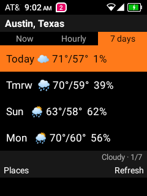
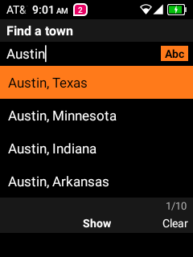

# Fiero Weather

A small weather app for **keypad Android flip phones**, built on and for the TCL Flip 2. Everything works from
the keypad; no touch screen, Google Play services or account needed.

<p>
  
  
</p>

## What it does

- **Now:** temperature, conditions, feels-like, today's high / low, chance of rain, wind, humidity, sunset.
- **Hourly:** the next 24 hours, with chance of rain.
- **7 days:** high / low, conditions and chance of rain for the week.
- **Where you are**, or any town you add. Search with multi-tap typing (`#` switches Abc / abc / ABC / 123).
- Opens instantly with the last forecast and refreshes it when it's over 30 minutes old. Still shows the
  last forecast (and when it's from) with no signal.
- US units: °F, mph.

## Keys

| Key | Action |
|---|---|
| ◀ ▶ (or `1` `2` `3`) | Now / Hourly / 7 days |
| ▲ ▼ | Scroll the hours or days |
| Left soft key | Places |
| Right soft key | Refresh |
| Back | Close |

**Places:** ▲▼ move, OK shows that place, left soft key removes a saved town. Start typing to find a town,
OK to search, OK again on a result to add and show it. Back deletes a letter, right soft key clears.

## Install

You need a computer with [adb](https://developer.android.com/tools/releases/platform-tools) and USB debugging
turned on in the phone's Developer options.

```bash
adb install -r fiero-weather-0.1.0.apk
adb shell pm grant dev.mike.fieroweather android.permission.ACCESS_COARSE_LOCATION   # or allow it on first start
```

It shows up as **Fiero Weather** in the app list (on [Fiero Launcher](https://github.com/SuperFieroStatus/fiero-launcher),
type `9328`).

## Privacy and data sources

- Forecasts and town search: [Open-Meteo](https://open-meteo.com/) (free, no key, no account).
- The name of the town you're in: [Photon](https://photon.komoot.io/) (OpenStreetMap data).
- Your position is rounded to about 1 km before it's sent anywhere. No accounts, ads or tracking.

## Build

Requirements: JDK 17+ and the Android SDK (Android Studio provides both).

```bash
./gradlew assembleRelease     # app/build/outputs/apk/release/app-release.apk (R8-shrunk)
./gradlew testDebugUnitTest   # forecast parsing and keypad typing tests
```

The release build is signed with your **debug key** for convenience; use your own keystore if you distribute
it. On Windows, `scripts\deploy.ps1` builds, installs, grants location and launches in one go (`-Release`).

Plain Kotlin and Android Views, no runtime dependencies. Weather symbols are emoji, so there are no image
assets.

## Related

- [Fiero Launcher](https://github.com/SuperFieroStatus/fiero-launcher): a minimal keypad home screen.
- [Fiero Nav](https://github.com/SuperFieroStatus/fiero-nav): keypad-first turn-by-turn driving navigation.
- [FlipSpot](https://github.com/SuperFieroStatus/flipspot): a keypad Spotify front end.

## License

[MIT](LICENSE)
